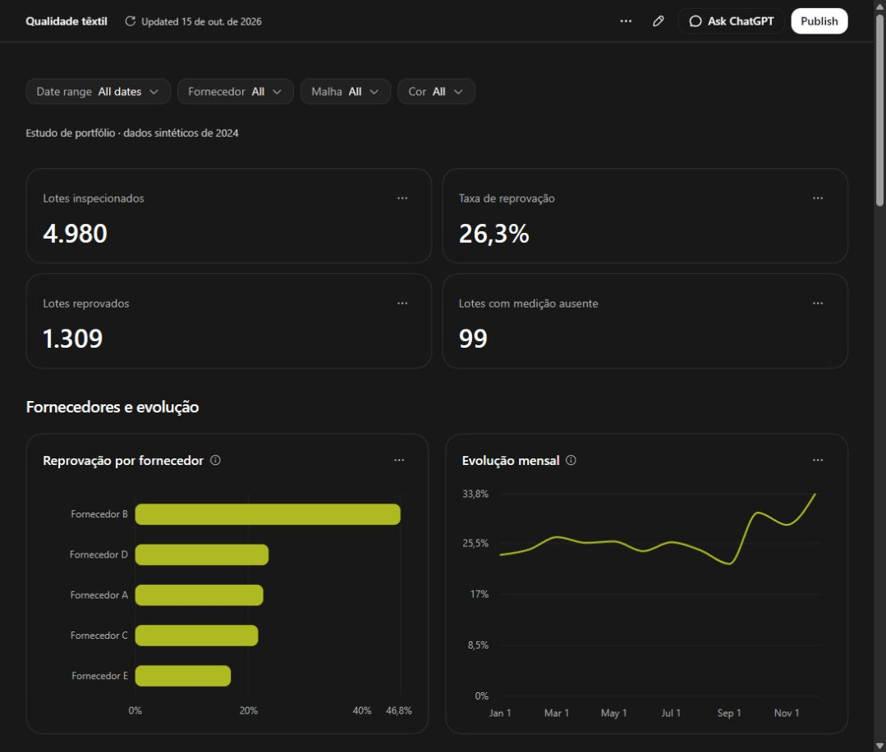

# Análise de qualidade têxtil

Projeto de portfólio que conecta experiência em inspeção de malhas com **Python, pandas, SQL e um dashboard interativo**. Explora diferenças de reprovação entre fornecedores, períodos e materiais.

**Todos os dados são sintéticos.** Os padrões foram inseridos no gerador para praticar análise; não representam fornecedores reais nem comprovam ganhos operacionais.

[**Abrir dashboard público**](https://danielobys.github.io/analise-qualidade-textil/?view=1&tab=dashboard) | [Código e notebook](https://github.com/Danielobys/analise-qualidade-textil)



## Resultados da base incluída

| Indicador | Resultado |
|---|---:|
| Registros brutos | 5.000 |
| Lotes únicos após limpeza | 4.980 |
| Lotes reprovados | 1.309 |
| Taxa geral de reprovação | 26,3% |
| Lotes com gramatura ou torção ausente | 99 |
| Período observado | 01/01/2024 a 30/12/2024 |

O fornecedor B apresenta 46,8% de reprovação em 956 lotes; o E, 16,9% em 806 lotes. São comparações descritivas da simulação, sem ajuste pela composição das malhas. Uma taxa isolada não determina a confiabilidade de um fornecedor real.

## Explore o dashboard

Na raiz do projeto:

```sh
python -m http.server 4173 --bind 127.0.0.1 --directory dashboard/app/dist
```

Abra http://127.0.0.1:4173/. Há filtros de período, fornecedor, malha e cor; evolução mensal; Pareto; mapa de calor; gramatura fora da faixa e tabelas por lote. Não precisa de PostgreSQL para abrir.

O HTML precisa ser servido junto do JSON, por HTTP.

## Organização

- data/: gerador, CSV bruto e tratado.
- notebooks/: limpeza, análise e visualizações com saídas executadas.
- sql/: modelagem e consultas PostgreSQL.
- dashboard/: documentação, interface e compilado em app/dist.
- assets/: imagens dos resultados.
- scripts/: validação e preparação do site.
- docs/: compilado para GitHub Pages.

## Metodologia

1. Simulação com semente 42, duplicatas, nulos, inconsistências de texto e erros artificiais de gramatura.
2. Padronização dos fornecedores e datas, deduplicação por lote e correção do erro conhecido. Nulos permanecem ausentes.
3. Análise dos defeitos, gramatura, fornecedores e taxas mensais. As médias trimestrais do notebook são médias simples das taxas mensais.
4. SQL com staging, dimensão de fornecedores e fato de inspeções; ranking mensal, evolução semanal com janelas e presença de defeito visual entre reprovações.
5. Dashboard com snapshot do CSV tratado e taxas recalculadas para cada recorte, sem conexão ativa ao banco.

## Reproduzir a análise

Python 3.13 foi usado na validação. No Windows:

```powershell
python -m venv .venv
.venv\Scripts\python -m pip install -r requirements.txt
.venv\Scripts\python -m notebook notebooks/analise_exploratoria.ipynb
```

Execute todas as células com a pasta notebooks como diretório de trabalho. Os CSVs incluídos preservam os resultados deste estudo. Regenerar é opcional: dentro de data, execute python gerar_dados.py e depois reexecute o notebook.

Para conferir a equivalência entre CSV e dashboard:

```sh
python scripts/verificar_dados.py
```

Para SQL, use PostgreSQL em banco dedicado de estudo:

```sh
createdb qualidade_textil
cd sql
psql -d qualidade_textil -f consultas_analiticas.sql
```

O script recria tabelas no esquema qualidade_textil, interrompe em erro e protege a carga com transação. **Validado em PostgreSQL 18:** carga de 4.980 lotes, 1.309 reprovados e execução das três consultas; segunda execução concluída com sucesso em banco temporário isolado.

## Limitações

- Deduplicação mantém a primeira ocorrência; uma cópia posterior pode ter medição preenchida.
- Dividir gramaturas acima de 400 por dez trata apenas o erro artificial conhecido.
- Gramatura fora da faixa usa medições preenchidas e tolerância de 5% da amplitude da faixa da malha.
- O status original não é recalculado após limpeza. Há reprovações sazonais sem causa registrada; ausência de defeito visual não comprova falha técnica.
- O SQL distingue presença de defeito visual, sem afirmar causa raiz. A média móvel usa quatro semanas observadas, sem ponderação por volume.
- Não há modelo preditivo, dashboard Power BI ou redução real de perdas demonstrada.
- A interface utiliza a base Data do Codex. Executar o compilado exige servidor estático; recompilar exige esse runtime, conforme dashboard/app/AGENTS.md.
- Dependências Python têm versões mínimas, sem lock completo. Outra versão do Faker pode alterar uma nova geração. A base incluída é a referência dos resultados.

## Autor

Daniel Correia Lemos Júnior. Experiência em inspeção de matéria-prima têxtil e estudos de análise de dados. Projeto desenvolvido com apoio de IA na revisão e construção da interface, com fontes, definições e limitações disponíveis para inspeção.

